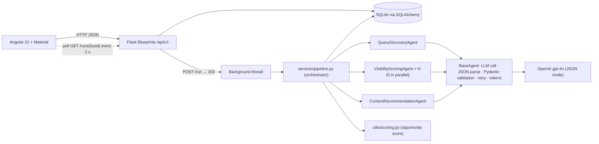

# AI Visibility Intelligence Platform

A Flask multi-agent API plus an Angular dashboard that answers one question for a
business: **"When people ask AI assistants about my industry, am I mentioned, and what
content should I create to fix that?"**

For a business profile the pipeline:

1. **discovers** 10–20 questions real customers ask AI assistants about the industry,
2. **scores** each question: simulates an AI answer, checks whether the business's domain is
   mentioned (and at which position). Search volume and difficulty come from DataForSEO,
3. **recommends** 3–5 pieces of content (blog post, landing page, FAQ) for the biggest gaps.

This file documents the whole project (backend, architecture, agents, scoring, decisions).
Frontend-specific setup is in [`../frontend/README.md`](../frontend/README.md).

---

## Quick start (Docker, recommended)

Requirements: Docker Desktop (or Docker Engine + Compose v2) and an OpenAI API key.

```bash
# from the repository root
cp backend/.env.example backend/.env        # Windows PowerShell: Copy-Item backend/.env.example backend/.env
# edit backend/.env and set OPENAI_API_KEY=sk-...
docker compose up --build
```

| Service  | URL                      |
|----------|--------------------------|
| Frontend | http://localhost:4200    |
| API      | http://localhost:5000/api/v1 |

Migrations run automatically when the backend container starts. The SQLite database lives
in the `backend-data` Docker volume, so data survives restarts (`docker compose down -v`
wipes it).

First build takes about 2–3 minutes (npm install + Angular production build); later starts
take seconds.

---

## Manual setup (without Docker)

### Backend

Requirements: Python 3.12+ (developed on 3.14).

```bash
cd backend
python -m venv .venv
# macOS / Linux
source .venv/bin/activate
# Windows PowerShell
.venv\Scripts\Activate.ps1

pip install -r requirements.txt
cp .env.example .env                        # then set OPENAI_API_KEY
flask --app app:create_app db upgrade       # creates instance/dev.db
flask --app app:create_app run --port 5000
```

The API is now on http://localhost:5000/api/v1.

### Frontend

```bash
cd frontend
npm install
npx ng serve            # or: ng serve, if the Angular CLI is installed globally
```

Open http://localhost:4200. Details: [`../frontend/README.md`](../frontend/README.md).

> The assessment brief says `ng install && ng serve`. `ng install` is not an Angular CLI
> command; dependencies are installed with `npm install`.

### Environment variables (`backend/.env`)

| Variable            | Required | Default                 | Purpose |
|---------------------|----------|-------------------------|---------|
| `OPENAI_API_KEY`    | yes      | –                       | Key for the OpenAI API (all three agents). |
| `OPENAI_MODEL`      | no       | `gpt-4o`                | Model used by every agent. |
| `ANTHROPIC_API_KEY` | no       | –                       | Listed by the spec; not used (OpenAI was chosen, see below). |
| `DATABASE_URL`      | no       | `sqlite:///dev.db`      | SQLAlchemy URL. Relative SQLite paths live in `backend/instance/`. PostgreSQL URLs also work. |
| `FLASK_ENV`         | no       | `production`            | `development` turns on Flask debug mode. |
| `SECRET_KEY`        | no       | `change-me`             | Flask secret key. |
| `CORS_ORIGINS`      | no       | `http://localhost:4200` | Comma-separated origins allowed to call `/api/*`. |
| `DATAFORSEO_LOGIN`  | yes      | –                       | DataForSEO API login. A run fails closed without it. |
| `DATAFORSEO_PASSWORD` | yes    | –                       | DataForSEO API password, not the website login password. |
| `DATAFORSEO_BASE_URL` | no     | `https://api.dataforseo.com` | Live API host. |
| `DATAFORSEO_LOCATION_CODE` | no | `2840`              | Google Ads location. `2840` is the United States. |
| `DATAFORSEO_LANGUAGE_CODE` | no | `en`                | Google Ads language. |

`.env` is git-ignored; only `.env.example` is committed.

---

## Architecture



### Request flow of a pipeline run

1. `POST /api/v1/profiles/{uuid}/run` creates a `PipelineRun` with status `running`,
   starts a daemon thread and immediately returns **202** with the run.
2. The thread runs discovery → scoring → recommendations, committing progress after every
   scored query (`queries_discovered`, `queries_scored`, `tokens_used`).
3. The Angular app polls `GET /api/v1/runs/{run_uuid}` every 2 s (RxJS `interval` +
   `takeUntil`) and shows live progress. When the status becomes `completed` or `failed`
   it shows a snackbar, the summary card, and reloads the Queries / Chart /
   Recommendations tabs.

### Code layout

```
backend/
  app/
    __init__.py          create_app(), Config, db/migrate, CORS, JSON error handlers
    models/              profile.py · run.py · query.py · recommendation.py
    agents/              base.py · discovery.py · scoring.py · recommendation.py
    api/                 profiles.py · queries.py   (Blueprints)
    services/pipeline.py orchestrator, background runner, recheck
    utils/scoring.py     opportunity score (pure function)
  migrations/            Flask-Migrate (Alembic) migrations
  tests/                 pytest suite with a stubbed LLM
```

Files added beyond the suggested structure, and why:

| File | Reason |
|------|--------|
| `app/models/run.py` | The spec lists a `PipelineRun` model but no file for it. |
| `Dockerfile`, `.dockerignore` (backend and frontend), `frontend/nginx.conf` | Needed for `docker compose up`; nginx serves the built Angular app with SPA route fallback. |
| Root `.gitignore` | Keeps `.env`, databases, `node_modules`, builds out of git. |
| `frontend/src/app/core/services/api-error.ts` | One shared `catchError` mapper so every service returns the same typed error. |
| `frontend/src/app/shared/components/score-chip/` | Reusable colour-coded score chip (the spec's `shared/components/` folder). |
| `frontend/src/app/shared/components/skeleton/` | Shimmer placeholder used by every view's first load (bonus). |
| `frontend/src/app/core/services/csv-export.service.ts` | Builds and downloads the queries CSV (bonus). |
| `frontend/src/app/core/services/theme.service.ts` | Dark-mode toggle and `localStorage` (bonus). |
| `frontend/src/app/core/animations/route.animations.ts` | Route fade used by the shell and the profile tabs (bonus). |

---

## Data model

All primary keys are UUID strings (`String(36)`), foreign keys cascade on delete, and
SQLite foreign keys are switched on with `PRAGMA foreign_keys=ON`.

| Model | Table | Key fields |
|-------|-------|-----------|
| `BusinessProfile` | `business_profiles` | uuid, name, domain, industry, description, competitors (JSON), status `created / running / completed / failed`, created_at, updated_at |
| `PipelineRun` | `pipeline_runs` | uuid, profile_uuid (FK), status `running / completed / failed`, queries_discovered, queries_scored, tokens_used, error_message, started_at, completed_at |
| `DiscoveredQuery` | `discovered_queries` | uuid, profile_uuid (FK), run_uuid (FK), query_text, search_keyword, estimated_search_volume, competitive_difficulty, opportunity_score, domain_visible (nullable), visibility_position, discovered_at |
| `ContentRecommendation` | `content_recommendations` | uuid, profile_uuid (FK), query_uuid (FK), content_type `blog_post / landing_page / faq`, title, rationale, target_keywords (JSON), priority `high / medium / low`, created_at |

Check constraints enforce the enums and ranges (score 0–1, difficulty 0–100, volume ≥ 0,
position ≥ 1). The initial migration is `migrations/versions/20599215a9b8_initial_schema.py`.

---

## API reference

Base URL: `http://localhost:5000/api/v1`. All bodies are JSON.

### Specified endpoints

| Method | Path | Success | Notes |
|--------|------|---------|-------|
| `POST` | `/profiles` | 201 | Create a business profile. |
| `GET`  | `/profiles/{profile_uuid}` | 200 | One profile. |
| `POST` | `/profiles/{profile_uuid}/run` | 202 | Start the pipeline (async). 409 if a run is already in progress. |
| `GET`  | `/profiles/{profile_uuid}/queries` | 200 | Queries of the latest completed run. Params: `min_score` (0–1), `status` (`visible / not_visible / unknown`), `page` (≥1), `per_page` (1–100, default 20). Sorted by score, highest first. |
| `GET`  | `/profiles/{profile_uuid}/recommendations` | 200 | Recommendations of the latest completed run, high priority first. `empty_reason` is `no_completed_run`, `all_visible`, `generation_failed`, or `null`. Each item includes `query_text`. |
| `POST` | `/queries/{query_uuid}/recheck` | 200 | Re-run the visibility check for one query, rebuild that run's recommendations, and return the updated query. 502 if the visibility check fails. |

### Extra endpoints (needed by the dashboard and polling)

| Method | Path | Purpose |
|--------|------|---------|
| `GET` | `/profiles` | List profiles (dashboard). |
| `GET` | `/stats` | `total_profiles`, `total_queries_discovered`, `avg_opportunity_score` (dashboard cards). |
| `GET` | `/runs?profile_uuid=&limit=` | Recent runs, newest first (`limit` 1–50, default 10). |
| `GET` | `/runs/{run_uuid}` | One run; polled while the pipeline runs. |

### Examples

Create a profile:

```http
POST /api/v1/profiles
{
  "name": "Surfer SEO",
  "domain": "surferseo.com",
  "industry": "SEO Software",
  "description": "AI-powered SEO content optimization tool",
  "competitors": ["clearscope.io", "marketmuse.com", "frase.io"]
}
```

```json
{
  "profile_uuid": "b81abdc7-4f27-4ec6-9624-c71a65270c49",
  "name": "Surfer SEO",
  "domain": "surferseo.com",
  "industry": "SEO Software",
  "description": "AI-powered SEO content optimization tool",
  "competitors": ["clearscope.io", "marketmuse.com", "frase.io"],
  "status": "created",
  "created_at": "2026-11-04T18:44:39.767683+00:00",
  "updated_at": "2026-11-04T18:44:39.767683+00:00"
}
```

Start a run → `202`:

```json
{
  "run_uuid": "5d1c…",
  "profile_uuid": "b81abdc7-…",
  "status": "running",
  "queries_discovered": 0,
  "queries_scored": 0,
  "tokens_used": 0,
  "error_message": null,
  "started_at": "2026-11-04T18:44:40+00:00",
  "completed_at": null
}
```

List queries (`GET /profiles/{uuid}/queries?min_score=0.5&status=not_visible&page=1&per_page=10`):

```json
{
  "items": [
    {
      "query_uuid": "0f3e…",
      "profile_uuid": "b81abdc7-…",
      "run_uuid": "5d1c…",
      "query_text": "What are the best AI tools for SEO content optimization?",
      "search_keyword": "best ai tools seo content optimization",
      "estimated_search_volume": 25000,
      "competitive_difficulty": 75,
      "opportunity_score": 0.6278,
      "domain_visible": false,
      "visibility_position": null,
      "discovered_at": "2026-11-04T18:44:45+00:00"
    }
  ],
  "page": 1,
  "per_page": 10,
  "total": 1,
  "total_pages": 1,
  "run_uuid": "5d1c…"
}
```

`run_uuid` is `null` when the profile has no completed run yet.

Recommendations (`GET /profiles/{uuid}/recommendations`) return
`{"items": [...], "total": 3, "run_uuid": "5d1c…"}`; one item:

```json
{
  "recommendation_uuid": "a8c2…",
  "target_query_uuid": "0f3e…",
  "profile_uuid": "b81abdc7-…",
  "content_type": "blog_post",
  "title": "The Complete Guide to AI Tools for SEO Content Optimization",
  "rationale": "AI assistants answer this high-volume question with competitor tools only…",
  "target_keywords": ["ai seo tools", "seo content optimization", "content optimization software"],
  "priority": "high",
  "query_text": "What are the best AI tools for SEO content optimization?",
  "created_at": "2026-11-04T18:44:57+00:00"
}
```

### Errors

Every error uses one shape:

```json
{
  "error": {
    "code": "validation_error",
    "message": "Some fields are invalid.",
    "details": { "domain": "Enter the domain only, without http:// or https:// (e.g. example.com)." }
  }
}
```

| Status | When |
|--------|------|
| 400 | Invalid body or query parameter (`details` names the field). |
| 404 | Unknown profile, run or query UUID. |
| 409 | `pipeline_already_running` for this profile. |
| 502 | `llm_unavailable` / `recheck_failed`: the LLM call or its output failed during a recheck. |
| 500 | Unexpected error (logged; the session is rolled back). |

Profile validation: name, domain, industry and description are required; the domain must
be a bare domain (`example.com`, no protocol, path or spaces); up to 10 competitor domains,
de-duplicated, and a competitor cannot be the business's own domain.

---

## Agent design

Three agent classes, each with one job, a named system-prompt constant that contains its
JSON schema, a Pydantic v2 output model, and business-rule checks. They share
`BaseAgent` (`app/agents/base.py`).

### BaseAgent: the safety net around every LLM call

```
build user message → LLM call (JSON mode) → strip ``` fences → json.loads
  → Pydantic validation → agent-specific post_validate → AgentResult(ok=True, data, tokens)
                ↘ on bad JSON / schema error / rule violation:
                  retry once, telling the model exactly what was wrong
                ↘ still invalid, or provider error: AgentResult(ok=False, error, tokens)
```

* The OpenAI call uses `response_format={"type": "json_object"}`, a 60 s timeout and the
  SDK's 2 transport retries.
* Agents never raise on bad model output; they return `AgentResult(ok=False, …)` and the
  orchestrator decides what that means. Tokens are counted on every attempt, including
  failed ones.
* `LLMClient` is a small protocol, so tests swap in a fake client and never call OpenAI.

### 1. Query Discovery Agent (`agents/discovery.py`)

* **Input:** name, domain, industry, description, and competitors. Each competitor is sent as
  its domain plus the name the model may write (the domain label, such as `clearscope` for
  `clearscope.io`).
* **Output saved:** 10–20 `query_text` strings. The model also returns `offerings` and, on
  each question, `offering_label` and `intent`. Those fields are checked and then discarded.
* **Prompt:** works for any industry. The model copies a `profile_quote` from the industry or
  description, then writes buyer questions that may use synonyms. At most 3 questions use the
  exact registered name. A comparison must use that registered name and exactly one listed
  competitor, as in "How does Surfer SEO compare to Clearscope?". Two competitors, or a
  competitor without the business name, are rejected. Definitions and DIY tutorials are rejected.
* **Post-validation:** every kept question must point at an offering grounded in the profile,
  and it must be a buyer question. Missing `?` is added. Competitor names are matched on
  word boundaries, and a comparison is kept only when the business name and exactly one
  competitor are both present. Invalid questions are dropped. The run fails only when fewer
  than 10 valid questions remain; the agent retries once and a second failure saves nothing.
* Temperature 0.4 so the model stays closer to the plan instead of inventing extra wording.

### 2. Visibility Scoring Agent (`agents/scoring.py`)

* **Input:** one question plus the industry.
* **Output:** `simulated_answer` and `mentioned_brands` (ordered `{name, domain}` list).
  The model does not estimate search volume or difficulty. Those numbers come from
   DataForSEO for a short Google keyword written by a separate keyword agent.
* **Key design choice:** the target domain is **not sent to the model**. If the prompt said
  "is surferseo.com mentioned?", the model would be biased towards mentioning it. Instead
  the model writes a neutral answer and lists the brands it mentioned. Code then decides
  `domain_visible` and `visibility_position` by matching the domain, a flexible business
  name (`Surfer`, `SurferSEO`, and `Surfer SEO` are the same brand), and the simulated
  answer text when the brand list leaves the business out.
* Temperature 0.3. Each query is scored independently, five at a time in a thread pool.

### 3. Content Recommendation Agent (`agents/recommendation.py`)

* **Input:** the profile and the top 5 **not visible** queries by opportunity score.
* **Output:** `{"recommendations": [{target_query_uuid, content_type, title, rationale,
  target_keywords, priority}]}`. The prompt asks for 3–5. One or two valid items are kept
  when that is all the model can ground; zero valid items fails the step.
* **Rules:** `content_type` ∈ `blog_post | landing_page | faq`. `priority` is set in code
  from the target query's opportunity score, using the same bands as the score chip
  (`high` ≥ 0.7, `medium` 0.4–0.69, `low` < 0.4). Titles are category-level, without the
  brand name or years; 3–8 lowercase keywords each (prompt), at most 10 accepted (schema).
* **Post-validation:** drops items whose `target_query_uuid` was not in the input,
  de-duplicates keywords, keeps at least 1 valid item and at most 5. The API adds
  `query_text` so each card can show the question it targets.
* **Recheck:** after a query is scored again, recommendations for that run are generated
  again from the current top gaps. A query that becomes visible drops out of that set.
* Temperature 0.5.

### Orchestrator and partial-failure handling (`services/pipeline.py`)

| Situation | Result |
|-----------|--------|
| Keyword generation fails | Run continues. Questions are saved without a keyword, so they have no volume or difficulty. Visibility still runs. The error is recorded. |
| SEO API missing, down, or not `20000` | Run `failed`. `error_message` is `SEO API not working properly.` No score is written. A failure before discovery saves no queries. |
| Discovery fails | Run `failed`, `error_message` explains why. |
| Some queries fail scoring | Run continues. Failed queries keep `domain_visible = null` (shown as **unknown**) and can be rechecked. Run ends `completed` with `queries_scored < queries_discovered` and the per-query errors in `error_message`. |
| Every query fails scoring | Run `failed`. |
| Recommendation agent fails | Run `completed` (queries are still useful), error recorded. |
| Domain visible for every query | Run `completed` with no recommendations (nothing to fix). |
| Any unexpected exception | Caught; the `finally` block always finalises the run (status, `completed_at`, error text truncated to 2000 chars). |
| Server restarted mid-run | A run stuck in `running` for over 15 minutes is marked `failed` the next time the profile is run. |

`profile.status` mirrors the latest run. Tokens from all agents (and rechecks) are summed
into `PipelineRun.tokens_used`.

---

## Opportunity score formula

```
opportunity_score = gap × (0.6 × volume + 0.4 × ease)        → clamped to 0.0–1.0

volume = log10(estimated_search_volume + 1) / log10(1 000 001)   (capped at 1.0)
ease   = 1 − competitive_difficulty / 100
gap    = 1.0  if the domain is not visible
         0.1 / 0.3 / 0.5  if visible at position 1 / 2 / 3
         0.7  if visible at position 4 or lower
         0.5  if visibility is unknown (scoring failed)
```

**Why these factors**

* **Gap** is the main multiplier: the score answers "how much is there to gain?", so a
  query where the business is already the first brand mentioned should rank near the
  bottom regardless of its size, and a query where it is absent should rank near the top.
* **Volume** is how much demand there is. It is log-scaled because search volumes span many
  orders of magnitude: 100 → 10,000 searches is a real difference, 1 M → 1.1 M is not.
  1,000,000 monthly searches counts as maximum demand, so a 100,000-search query still
  ranks below a 1,000,000-search query.
* **Ease** is the inverse of Google Ads `competition_index` (0–100), stored as
  `competitive_difficulty`. A phrase with less paid competition scores as easier. This is
  advertiser competition, not a measurement of how hard it is to be named in an AI answer.
* Volume weighs more than ease (0.6 vs 0.4) because demand is the bigger driver of value,
  and both together can never exceed 1, so the score is always in 0–1.

**Worked example** (real values from a run):

| Query | Volume | Difficulty | Visible | volume | ease | gap | Score |
|-------|--------|-----------|---------|--------|------|-----|-------|
| "How does ClickUp compare to other project management tools?" | 25,000 | 70 | no | 0.733 | 0.30 | 1.0 | 1.0 × (0.4398 + 0.120) = **0.5598** |
| "Is Notion good for both personal and professional use?" | 50,000 | 70 | #1 | 0.783 | 0.30 | 0.1 | 0.1 × (0.4699 + 0.120) = **0.059** |

The second query has twice the volume but scores far lower because Notion already wins it.
That is the ordering the dashboard needs: work on what you are missing first.

---

## AI model selection

* **Provider / model:** OpenAI **`gpt-4o`** (configurable with `OPENAI_MODEL`).
* **Why:** strong instruction following for long structured prompts, native JSON mode
  (`response_format=json_object`) which removes most parse failures, good world knowledge of
  brands and domains (needed for realistic simulated answers), and low latency. A full run
  (~16 queries) takes about 20 seconds and uses about 10–11k tokens.
* The `LLMClient` protocol keeps the provider behind one class, so adding Anthropic Claude
  would be one more client implementation; it was not needed for the brief.

---

## Tradeoffs and design decisions

These cover every point the brief leaves open.

| Topic | Decision | Why / consequence |
|-------|----------|-------------------|
| Run execution | Asynchronous: `POST /run` returns 202 and runs in a background thread; the UI polls. | No HTTP timeouts on a 20 s+ run, and live progress in the UI. A thread (not Celery/Redis) keeps the stack to what the brief names; a server restart loses a running job (handled by the 15-minute stale-run rule). |
| Search volume and difficulty | A keyword agent turns each question into a 2–4 word Google phrase. DataForSEO Google Ads Search Volume then returns `search_volume` and `competition_index` in one live call. Example: `Which company offers SaaS development?` becomes `saas development company`. Location defaults to the United States (`2840`), language `en`. | The rule-based keyword kept almost every word and was too long for a real Google search. The model writes only the phrase, never the numbers. If keyword generation fails, visibility still runs and those volumes stay empty. If the SEO API fails, the run fails with `SEO API not working properly.` and no score is saved. Volume is still log-scaled and reaches its maximum at 1,000,000 monthly searches. |
| AI visibility check | Simulated answer from `gpt-4o`, not live ChatGPT/Perplexity results. | There is no public API for "what does ChatGPT answer to users"; simulation is the practical approximation. |
| Status values | `PipelineRun.status` uses only `running / completed / failed`. A partial failure is `completed` + `error_message` + `queries_scored < queries_discovered`. | Keeps the spec's three values; the UI shows partial runs as "completed with warnings". |
| Profile status | `created / running / completed / failed`, mirrors the latest run. | Lets the dashboard show each profile's state. |
| Unknown visibility | `domain_visible` is nullable; `null` = unknown (scoring failed), exposed through `status=unknown`. | Avoids pretending a failed check means "not visible". |
| Query identifier | Exposed as `query_uuid` (spec names `recommendation_uuid`, `target_query_uuid`). | Consistent naming across objects. |
| Which run's data is shown | Queries, chart, recommendations, and the summary counts come from the latest **completed** run. Dashboard totals do the same, per profile. A newer failed run is shown as a warning and does not replace those counts. While a run is in progress, the tabs keep the previous completed results and say so. | A re-run does not mix old and new results, and the summary card matches the table. |
| Recommendations per run | The prompt asks for 3–5, from the top 5 not-visible queries. One or two valid items are saved instead of discarding the list. Priority is derived from the opportunity score (`high` ≥ 0.7, `medium` 0.4–0.69, `low` < 0.4). Recheck rebuilds that run's recommendations from the updated gaps. | A short but valid model reply still produces cards, and the badge matches the score chip. |
| Visibility match | Domain match is exact after normalisation. The business name also matches without spaces or hyphens, and a shorter prefix of at least four characters matches (`Surfer` matches `Surfer SEO`). If the brand list omits the business, the simulated answer text is checked too. | A missed spelling no longer marks a visible brand as absent and inflates its opportunity score. |
| Priority filter | Client-side (recommendations are at most 5 per run). | No extra API parameter needed. |
| Extra endpoints | `GET /profiles`, `GET /stats`, `GET /runs`, `GET /runs/{uuid}`. | The six specified endpoints cannot feed the dashboard stats, recent runs list or polling. |
| Domain validation | Bare domain regex (no protocol/path), same rules on backend and frontend, also for competitors. | Matches "no http://, just domain.com". |
| Comparison questions | A comparison must contain the registered business name and exactly one saved competitor. Competitor-versus-competitor questions are dropped. These questions count toward the 3 questions that may use the business name. | Matches the brief's example ("How does Surfer SEO compare to Clearscope?") and keeps every comparison about this business. |
| Database | SQLite by default (`DATABASE_URL` accepts PostgreSQL). | Zero setup for reviewers. |
| Provider | OpenAI only (`ANTHROPIC_API_KEY` stays in `.env.example` as the spec lists it). | One provider is enough; it is isolated behind `LLMClient`. |
| Server in Docker | Flask's built-in threaded server. | Simplicity for an assessment; a production deployment would use gunicorn. |
| Frontend stack | Angular 21 (spec: v17+), standalone components, strict TypeScript, Angular Material, ng2-charts. | Angular 22 needs Node 24.15+; 21 is the newest that runs on the development machine. |
| Empty-state "illustration" | Large Material icon + message. | Uses Angular Material only, no image assets. |
| README location | `backend/README.md` (this file) and `frontend/README.md`, as in the suggested structure. | No root README. |
| Dark mode | Material `color-scheme` theme. Toolbar toggle, saved in `localStorage` (`avi-theme`); with no saved choice it follows the OS. | Spec asks for a light/dark toggle. Chip and status colours have dark variants; chart axis colours follow the theme. |
| CSV export | Client-side utility service on the Queries tab. One request (`per_page` 100) of the queries matching the current filters. | A run discovers at most 20 queries, so one page is the full set. No new API endpoint. |
| Skeleton loaders | Custom shimmer component on the first load of every view. | Spinners stay for actions already in progress: Run Pipeline, Recheck, and form submit. |
| Route animations | `@angular/animations` fade-and-rise on the root outlet and the profile tabs. Skipped when the OS asks for reduced motion. | The spec names this package. |

---

## Bonus features implemented

* **Async processing:** background pipeline thread, 202 response.
* **Real-time polling:** RxJS `interval` + `takeUntil`, live "x / y queries scored".
* **Docker:** `docker compose up --build` runs backend and frontend.
* **Tests:** backend pytest suite and frontend service unit tests (below).
* **Dark mode:** toolbar toggle, Material light/dark theme, remembered in the browser.
* **CSV export:** "Export CSV" on the Queries tab downloads the filtered queries.
* **Skeleton loaders:** shimmer placeholders while a view's data is loading for the first time.
* **Route animations:** a short fade when changing page or profile tab.

---

## Testing

Backend (47 tests, about 25 s, no API key needed: the LLM is a stub):

```bash
cd backend
python -m pytest          # inside the virtual environment
```

Covers: malformed / fenced / schema-breaking LLM output and the retry, branded-query cap,
domain matching, recommendation rules; partial-failure runs (some queries fail, all fail,
discovery fails, recommendations fail); opportunity score range and ordering; API status
codes, validation details, pagination, filters, 404 / 409 and the error format.

Frontend (16 Jasmine tests: the three HTTP services with `provideHttpClientTesting`, plus CSV formatting):

```bash
cd frontend
npx ng test --watch=false --browsers=ChromeHeadless
```

Covers: request URLs, methods, params and bodies; response unwrapping; error mapping
(API envelope, plain-text errors, API unreachable); and that polling stops once a run
finishes.

---

## AI tools used

* **Cursor (Claude agent):** planning the build phase by phase, writing backend and frontend
  code, prompts and tests, and browser testing of the running app. Every phase was
  reviewed and approved by me before the next one started.
* **ChatGPT:** understanding and clarifying the assessment requirements.
